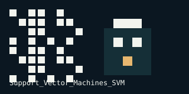

# Support Vector Machines SVM

---

<!-- demo-lab:start -->
## Explore this project

[Project page & walkthrough](https://eforus-overseer.github.io/demo-lab/projects/support_vector_machines_svm/) — Try an interactive explanation and inspect the original source and results. Browser teaching examples are distinguished from trained models.
<!-- demo-lab:end -->

<!-- codex-pixel-art -->
## Pixel art

A small visual signature for this repository.
